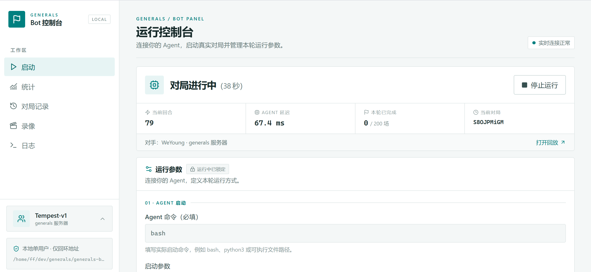

# Generals Bots Panel

一个本机运行的 generals.io 1v1 agent 控制台，支持公共服和 Bot 服。它通过 WebSocket 连接游戏，通过子进程标准输入和输出与外部 agent 通信，不包含策略模型，也不管理模型环境。



## 功能

- 启停外部 agent，查看实时对局状态、推理延迟和运行日志。
- 按 Player 隔离运行配置、战绩、对局历史和录像；切换 Player 不会停止其他 Player 的运行。
- 筛选真实对局、查看 Star 历史与单局详情，播放、下载或导入本地录像。

## 快速开始

需要 Node.js 24+ 和 npm。在仓库根目录运行：

```bash
npm ci
npm run dev
```

打开 <http://127.0.0.1:5173>。首次使用时，从左下角新增 Player，选择服务器并填写 User ID；控制台会查询该账号的昵称。随后在「启动」页填写自己的 agent 命令和参数：例如将 `bash` 填为命令，将脚本的绝对路径单独填为一个参数。默认使用 JSONL v2，协议见 [agent 协议](docs/agent-protocol.md)。

**点击「启动」会真实入队。** Dry-run 也会入队，只是不发送移动。请遵守游戏服务器规则。

生产模式（先安装依赖）：

```bash
npm run build
npm start
```

默认打开 <http://127.0.0.1:3000>。数据保存在本地 `data/`，其中的 User ID 未加密，请勿共享该目录。本工具可执行本机命令，服务只监听回环地址，不要通过代理或端口转发暴露到公网。

## 开发与文档

- `npm run check`：类型检查、ESLint、测试与格式检查。
- `npm run build`：构建前后端，不启动服务。
- [配置与验证](docs/configuration.md) · [agent 协议](docs/agent-protocol.md) · [文档索引](docs/README.md)

## 许可证

[MIT](LICENSE)
